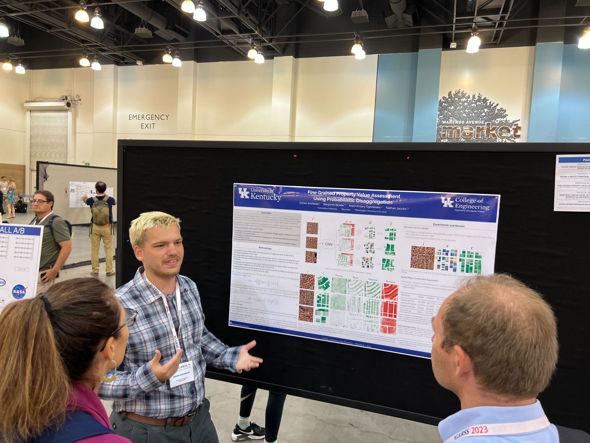

# About

I am a current PhD student at the University of Kentucky, looking to use my experience in machine learning and task driven computer vision to solve modern vision problems. My research focus includes applications of differential privacy in computer vision tasks, private generative modelling, AI ethics, explainability, and fairness. 

Beyond research, I enjoy teaching, mentoring, writing about ML topics, and contributing to open-source projects.
My personal hobbies include running, rock climbing, live music, reading, and most of all learning. 

Feel free to connect or check out my work

You can reach me at:
cgarchbold{at}gmail.com

:::note[My Links]
[Curriculum Vitae (CV)](https://cgarchbold.github.io/CV/)

[Linkedin](https://www.linkedin.com/in/cgarchbold/)

[Github](https://github.com/cgarchbold)
:::

# Quotes I Quite Enjoy

> “Without music, life would be a mistake.” ― Friedrich Nietzsche

> “Practice isn't the thing you do once you're good. It's the thing you do that makes you good.” ― Malcolm Gladwell

